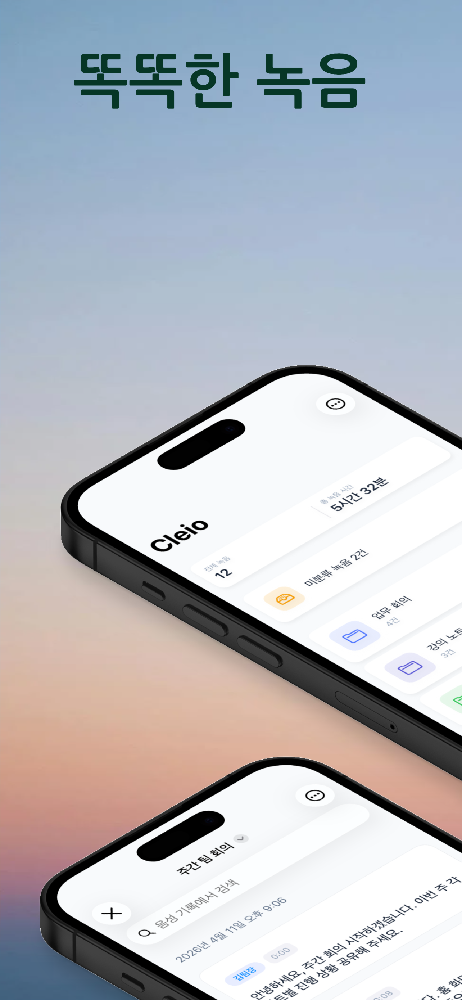
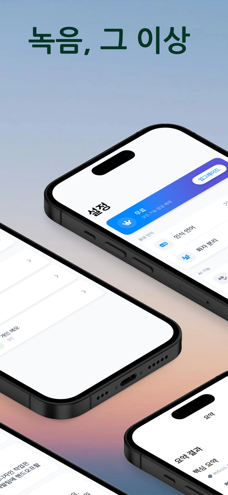
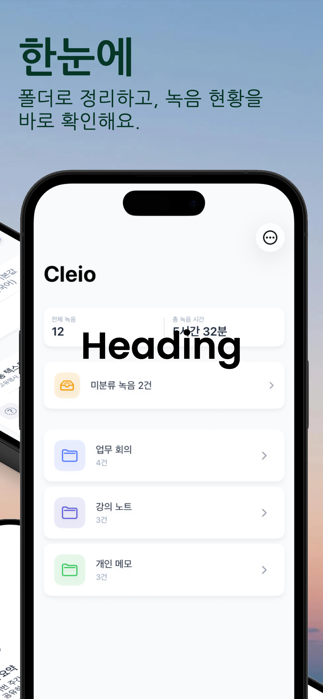
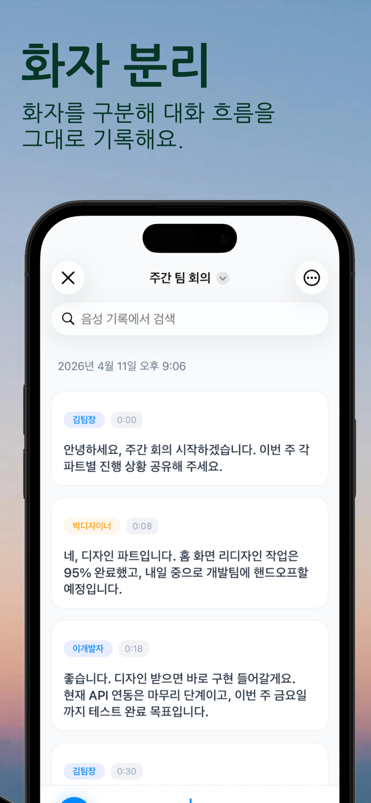
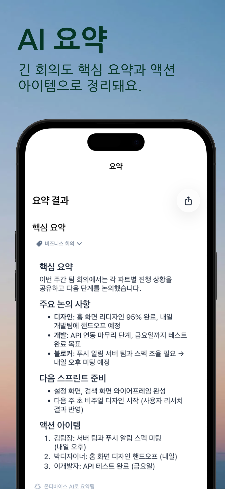

<!-- Hero -->
<section class="hero">
  <h1>녹음, 그 이상</h1>
  
녹음 한 번으로 음성 기록, 화자 분리, AI 요약까지. 회의에 집중하세요. 기록은 Cleio가 할게요.

  
</section>

<!-- Screenshots -->
<section class="screenshots" id="screenshots">
  

    <h2>한눈에 보는 Cleio</h2>
    
녹음부터 요약까지, 하나의 앱에서

  

  

    

      
      
      
      
      
    

  

</section>

<!-- Features -->
<section class="features" id="features">
  

    <h2>주요 기능</h2>
    
온디바이스 AI로 프라이버시를 지키면서

  

  

    

      
🎙️

      <h3>실시간 음성 기록</h3>
      
녹음과 동시에 음성을 텍스트로 변환해요. 온디바이스 AI가 인터넷 없이도 동작합니다.

    

    

      
👥

      <h3>실시간 화자 분리</h3>
      
녹음 중에도 누가 말하는지 실시간으로 구분해요. 참석자별 발언을 한눈에 확인할 수 있어요.

    

    

      
✨

      <h3>AI 요약</h3>
      
긴 회의도 핵심 요약, 주요 논의, 액션 아이템으로 자동 정리돼요.

    

    

      
📁

      <h3>보관함</h3>
      
모든 녹음과 요약을 한곳에서 폴더·주제·날짜별로 정리해요.

    

    

      
🔒

      <h3>프라이버시 우선</h3>
      
무료 기능은 전부 기기에서 처리되고, 음성 파일은 운영자의 서버나 제3자에게 전송되지 않습니다. Pro 클라우드 기능은 동의를 받은 뒤 텍스트만 전송합니다.

    

    

      
🌐

      <h3>다국어 지원</h3>
      
한국어, 영어, 일본어를 포함한 다양한 언어의 음성을 인식해요.

    

    

      
🌍

      <h3>다국어 회의 번역 (Pro)</h3>
      
외국어가 섞인 녹음도 원하는 언어로 번역해 음성 기록과 나란히 확인해요.

    

    

      
🔔

      <h3>미리 알림 연동</h3>
      
요약에서 추출한 할 일을 iOS 미리 알림과 양방향으로 동기화해요.

    

  

</section>

<!-- Pricing -->
<section class="pricing" id="pricing">
  

    <h2>요금제</h2>
    
무료로 시작하고, 필요할 때 업그레이드

  

  

    

      <h3>Free</h3>
      
무료

      
온디바이스 AI로 충분히 강력해요

      <ul class="pricing-features">
        <li>무제한 녹음</li>
        <li>실시간 음성 기록 (온디바이스)</li>
        <li>실시간 화자 분리</li>
        <li>온디바이스 AI 요약</li>
        <li>보관함 정리</li>
        <li>미리 알림 연동</li>
      </ul>
    

    

      <h3>Pro</h3>
      
₩6,600/월

      
$4.99 USD · ¥800 JPY

      
클라우드 AI로 더 정확하게

      <ul class="pricing-features">
        <li>Free의 모든 기능</li>
        <li>Cloud AI 고품질 요약</li>
        <li>다국어 회의 번역</li>
        <li>텍스트 교정 (Cloud AI)</li>
        <li>iCloud 동기화</li>
        <li>Markdown / PDF 내보내기</li>
      </ul>
    

  

</section>

<!-- CTA -->
<section class="cta">
  <h2>회의의 모든 순간을 기록하세요</h2>
  
지금 바로 Cleio를 무료로 시작해보세요.

  
</section>
